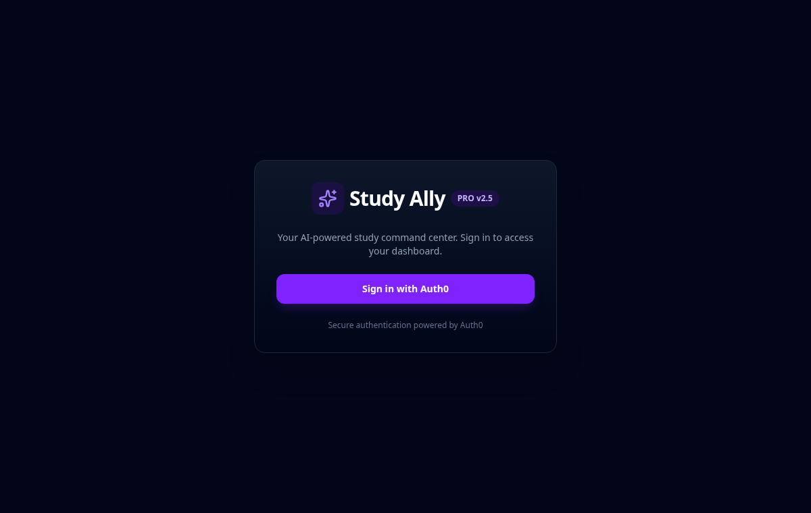

# Study Ally Pro 2.5

Study Ally Pro is a web app for organizing subjects and exams, planning study sessions, and tracking revision. This repository contains the React and TypeScript web version (package version 2.5.0); the repository name still uses 2.0.

## Try the web app

[Open Study Ally on Vercel](https://study-ally-2-0.vercel.app/). The web app uses Auth0 sign-in. Study records are stored in the current browser; sign-in does not sync them across devices.

### Demo preview

*Captured from a local run before signing in. The dashboard requires an Auth0 session.*

## Features

- Manage subjects, exams, and study materials.
- Plan study time, track progress, and schedule spaced revision.
- Use focus tools and review study logs and analytics.
- Use the AI coach and planning endpoints when Gemini is configured on the server. The server provides local fallback responses when the API key is absent.

## Run locally

1. Install a recent Node.js LTS and run `npm ci`.
2. Add your own Auth0 application domain and client ID as `VITE_AUTH0_DOMAIN` and `VITE_AUTH0_CLIENT_ID` in a local environment file. Register your local callback, logout, and web origin URLs in Auth0.
3. Optionally set `GEMINI_API_KEY` in the server environment. Do not commit a real key or add it to a `VITE_` variable.
4. Run `npm run dev` and open `http://localhost:3000` unless you have set another port.

Run `npm run lint` for TypeScript checks and `npm run build` to bundle the client and server.

## Verification status

The production build passed. A local smoke test also verified the offline coach and planner responses without sending anything to Gemini. The hosted app opened in Edge with an existing session; no study records were changed or captured. The TypeScript check currently reports an arithmetic type error in `src/components/DashboardTab.tsx`.

## Stack and contributors

React, TypeScript, Vite, Node.js, Express, Auth0, and the Gemini SDK.

Built by Winsten Banji and [Shashank B M](https://github.com/shashankbm666).
